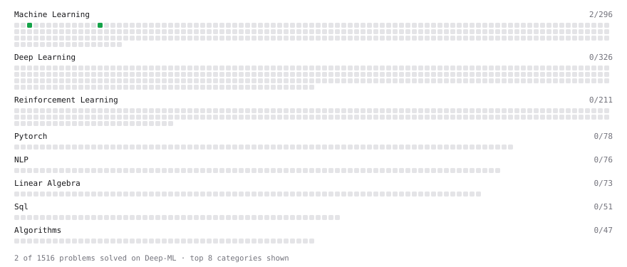

# Deep-ML

My machine learning practice from [Deep-ML](https://www.deep-ml.com). Every solution here was written by hand.

**7** solved · 7 problems · 0 labs · 0 math

[**Browse the interactive portfolio**](https://seeker-99.github.io/deep-ml/) to replay this filling in over time.

## Problems

| | Difficulty | Solved | |
| --- | --- | --- | --- |
| [Calculate Image Brightness](https://www.deep-ml.com/problems/70) | easy | 2026-08-11 | [solution](problems/0070-calculate-image-brightness) |
| [Feature Scaling Implementation](https://www.deep-ml.com/problems/16) | easy | 2026-08-10 | [solution](problems/0016-feature-scaling-implementation) |
| [Matrix-Vector Dot Product](https://www.deep-ml.com/problems/1) | easy | 2026-08-11 | [solution](problems/0001-matrix-vector-dot-product) |
| [One-Hot Encoding of Nominal Values](https://www.deep-ml.com/problems/34) | easy | 2026-08-10 | [solution](problems/0034-one-hot-encoding-of-nominal-values) |
| [Days Warmer Than the Previous Day](https://www.deep-ml.com/problems/1118) | medium | 2026-10-11 | [solution](problems/1118-days-warmer-than-the-previous-day) |
| [Nth-Highest Salary with Ties and NULL](https://www.deep-ml.com/problems/1110) | medium | 2026-10-12 | [solution](problems/1110-nth-highest-salary-with-ties-and-null) |
| [Salary Difference Between Departments with Conditional Aggregation](https://www.deep-ml.com/problems/1124) | medium | 2026-10-13 | [solution](problems/1124-salary-difference-between-departments-with-conditional-aggregation) |

---

_This file is regenerated by Deep-ML on every push._
